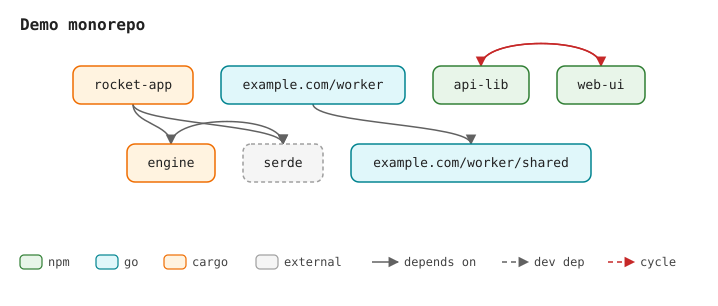

# depgraph

Offline dependency-graph visualizer for **npm / Go / Cargo** trees.
Point it at a directory: it scans every `package.json`, `go.mod` and
`Cargo.toml`, links the dependencies it can resolve on disk, detects
cycles, and renders a deterministic SVG.



Zero runtime dependencies, no network access, no lockfiles — edges are
drawn only between manifests that actually exist in the scanned tree.

## How linking works

| Format | A dependency is internal when… |
|---|---|
| npm | its name matches another scanned `package.json` name (workspace-style) |
| Go | a `replace <module> => ./local` points at a scanned module, or the required module path matches a scanned one |
| Cargo | a `path = "…"` dependency resolves to a scanned crate, or the crate name matches a scanned one |

Everything else is external and hidden unless you pass `--externals`
(then it becomes a gray dashed stub).

Cycles are found with Tarjan's strongly connected components and drawn as
red dashed arcs; `--cycles-only` turns the tool into a plain cycle
checker for CI.

## Usage

```
depgraph [ROOT] [options]

OPTIONS
  -o, --out <file>      output SVG path (default: dependencies.svg)
  -d, --depth <N>       keep nodes within N levels of the roots (default: 8)
      --externals       include unresolved dependencies as gray stub nodes
      --cycles-only     print cycles instead of drawing; exit 1 if any
      --format <f>      keep only one format: npm | go | cargo
      --title <text>    SVG title (default: "Dependency graph — <root>")
      --stdout          write the SVG to stdout instead of a file
  -h, --help            show this help
  -V, --version         print version
```

Requires Node **22.18+** (native TypeScript type stripping — there is no
build step and nothing to install).

```console
$ node src/cli.ts path/to/monorepo --externals
depgraph: 7 nodes, 6 edges, 1 cycle(s) -> dependencies.svg

$ node src/cli.ts . --cycles-only
cycle: api-lib -> web-ui -> api-lib
```

In a mixed monorepo each format keeps its own namespace, so an npm package
and a crate may share a name without colliding; node colors distinguish
them (green = npm, teal = go, orange = cargo).

## Exit codes

| Code | Meaning |
|---|---|
| 0 | success (or no cycles with `--cycles-only`) |
| 1 | runtime failure: no manifests found, or cycles found with `--cycles-only` |
| 2 | usage error: unknown flag, missing/invalid value |

## Development

```console
$ npm test        # 29 tests, node:test, no install step
```

The renderer is deterministic: the same graph always produces
byte-identical SVG, so output files diff cleanly.

### Limits

By design, depgraph never resolves names against a registry. A single
package that depends on twenty published libraries and nothing local
renders as one node — point it at workspaces, Go module subtrees with
local replaces, or Cargo path-dependency trees instead.

## License

MIT — see [LICENSE](LICENSE).
